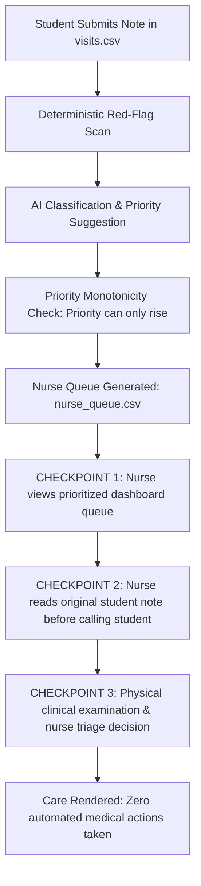

# JUDGMENT FRAMEWORK & HUMAN CHECKPOINT SPECIFICATION

**Course / Assessment:** CIT AI-Native Engineering Programme · Assessment 5  
**Document:** Judgment Framework Table & Human Oversight Model  
**Core Doctrine:** *The nurse sees every student and makes every clinical decision.*

---

## 1. The Asymmetric Risk Principle
In clinical and healthcare triage, the cost of errors is profoundly asymmetric:

$$\text{Cost}(\text{False Routine / Under-triage}) \gg \text{Cost}(\text{False Urgent / Over-triage})$$

- **Under-Triage (Priority too low):** If a student experiencing acute myocardial infarction, anaphylaxis, or acute asthma is erroneously marked as `routine`, they may wait 90+ minutes in the waiting hall, resulting in hypoxia, cardiac arrest, irreversible injury, or death. This is a **catastrophic failure**.
- **Over-Triage (Priority too high):** If a student with a mild sore throat is marked as `see_now`, the triage nurse visually inspects the student upon intake, recognizes mild non-urgent symptoms within 15 seconds, and re-sequences them appropriately. The cost is a negligible 15-second visual check.

**System Design Mandate:** The system is explicitly tuned to bias towards safety (`today` or `see_now`) whenever uncertainty exists. **Unknown is never routine.**

---

## 2. Judgment Framework Table

The table below breaks down each component of the Clinic Visit Sorter against the three fundamental AI governance questions:

| System Component | Q1: What happens when the AI gets this wrong? | Q2: Why is a priority that is too low far worse than one that is too high? | Q3: What is the human checkpoint and where does it intervene? |
|:---|:---|:---|:---|
| **Category Classification** (`injury`, `fever_cold`, `stomach`, `pain`, `allergy`, `other`) | A student with an insect sting may be mislabeled as `other` instead of `allergy`. This slightly misinforms administrative counts, but does not alter clinical care. | Category errors are informational only; they do not dictate immediate queue sequence. An incorrect priority, however, alters waiting time and can be fatal. | **Nurse Checkpoint 1 (Intake Scan):** The nurse glances at the original student note before calling the student into the examination room. |
| **Priority Assignment** (`see_now`, `today`, `routine`) | If assigned `routine` incorrectly, the student sits unmonitored during an acute medical deterioration. If assigned `see_now` incorrectly, the nurse does a rapid 15-second physical assessment. | A priority that is too low delays medical intervention during the "golden hour" of critical illness. A priority that is too high merely costs the nurse a few moments of visual triage. | **Nurse Checkpoint 2 (Queue Order Oversight):** The nurse retains sole authority to call students in whatever order clinical judgment dictates. The nurse sees 100% of students. |
| **Red-Flag Override** (`has_red_flag()`) | A false negative (missing a red flag) would leave prioritization to the LLM or lower tier. A false positive (e.g., student wrote "my friend had chest pain") promotes the note to `see_now`. | Missing a red flag risks patient collapse or death in the lobby. A false positive is resolved instantly by the nurse asking one question. | **Nurse Checkpoint 3 (Emergency Override):** The red-flag rule is a deterministic safety net. The nurse immediately verifies all `see_now` arrivals as they step up to the desk. |
| **Symptom Summary Generation** ($\le 12$ words) | The LLM might generate a vague summary or accidentally drop a symptom (e.g., summary mentions "fever" but omits "vomiting"). | A misleading diagnostic summary could anchor clinical assumptions. Hence, diagnosis is prohibited and the original text is preserved verbatim. | **Nurse Checkpoint 4 (Original Note Verification):** `nurse_queue.csv` and the web interface explicitly display the student's raw, unedited note alongside the summary. |
| **API Fallback / Error Handling** (Timeouts, JSON syntax errors, network drops) | The LLM fails to return a valid JSON object within 2 retry attempts. | Defaulting to `routine` on an error could bury an unclassified critical patient at the bottom of the queue. | **Nurse Checkpoint 5 (Failsafe Default):** The system automatically assigns `today` (same-day review) and tags the record with `"Could not classify, nurse to review"`. |

---

## 3. The 3 Human Checkpoints in Daily Operations

1. **Intake Triage View (Visual Scan):** The nurse monitors the dashboard. Any student flagged with a red badge (`see_now`) is immediately called to the desk for vital signs.
2. **Original Note Comparison:** The nurse never relies solely on the 12-word summary. The full verbatim note (including Tamil/Tanglish text) is displayed in the queue interface.
3. **Clinical Authority:** The system does not discharge students, does not write prescriptions, and does not close visit records. The human nurse makes 100% of medical and queue decisions.
